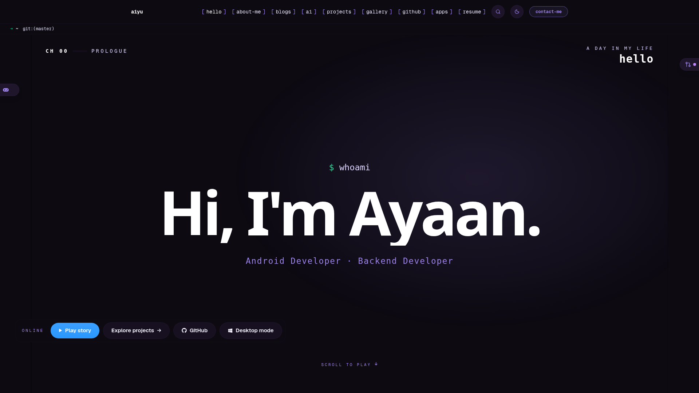
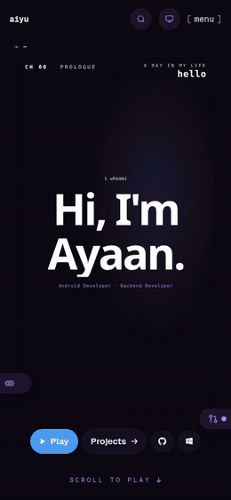
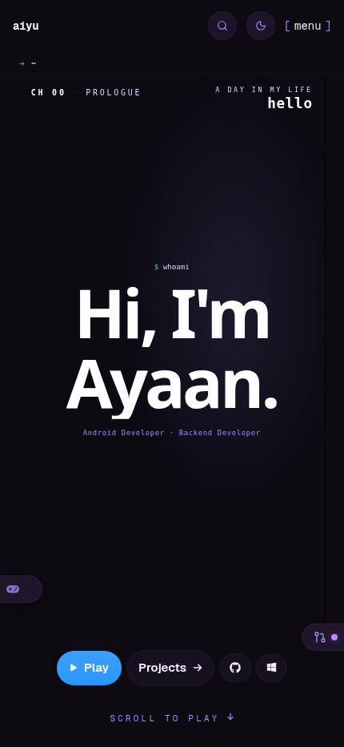
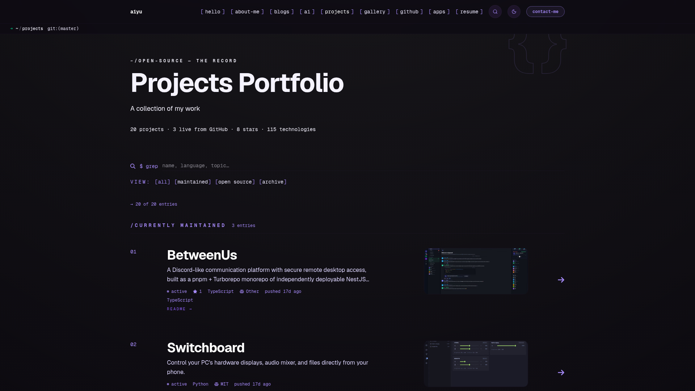
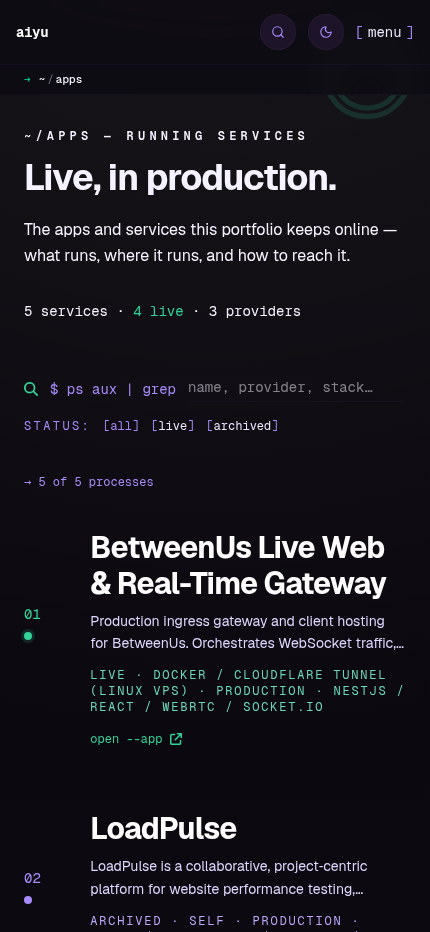
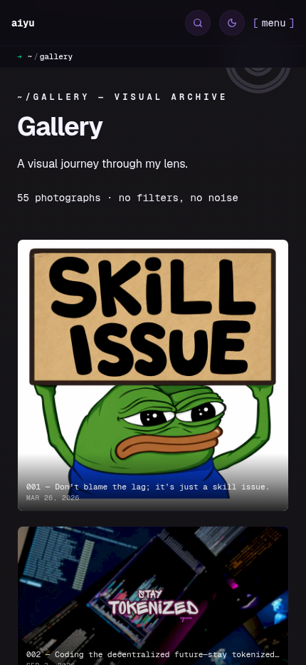
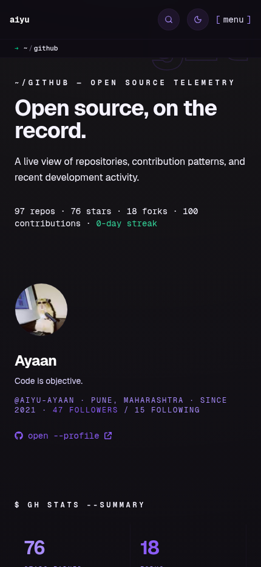
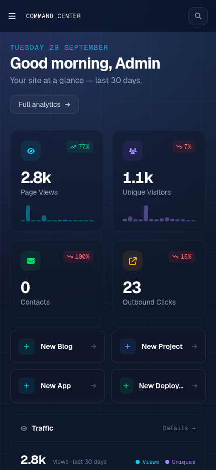

# 🌟 Aiyu - The Ultimate Developer Portfolio & CMS

[](https://opensource.org/licenses/MIT)
[](https://www.rust-lang.org/)
[](https://vite.dev/)
[](https://reactjs.org/)
[](https://www.sqlite.org/)
[](https://www.docker.com/)
[](https://github.com/aiyu-ayaan/Aiyu/wiki)
[](https://wakatime.com/badge/github/aiyu-ayaan/Aiyu)




A modern, responsive, and **fully customizable** portfolio website and Content Management System built with **Rust (Axum)**, **Vite**, **React 19**, **Tailwind CSS 4**, and **SQLite**. 

Featuring a gorgeous space-themed user interface, a highly advanced **Admin Panel**, an integrated **AI Neural Core (Gemini)**, and a visual **Task Scheduler**, `Aiyu` is designed for developers who want a production-ready, security-hardened portfolio with zero-hassle content management.

> [!TIP]
> **📚 Need full guides?** Explore the [Complete Documentation Wiki](https://github.com/aiyu-ayaan/Aiyu/wiki) or jump to the [Quick Start Guide](https://github.com/aiyu-ayaan/Aiyu/wiki/Quick-Start) to get running in 5 minutes!

---

## ✨ Features Spotlight

### 🧠 AI Neural Core (Gemini Integration)
Synthesize content, titles, and layouts directly from your admin panel:
- **AI Theme Architect**: Generate a beautiful, balanced 64+ token custom design system (light & dark modes) from a single concept prompt.
- **Creative Project Synthesis**: Generate catchy project names, write optimized professional summaries, and auto-map tech stacks.
- **Dynamic Subtitle Builder**: Contextually generates engaging subtitles for your projects, blogs, and gallery.

### ⏰ Task Scheduler & Cron Jobs
Full control over background tasks with a custom 60s ticking engine:
- **Visual Builder & Parser**: Select intervals via UI; a real-time translator converts expressions (e.g. `*/15 * * * *`) into human-readable text.
- **Automated Maintenance**: Auto-purge orphaned uploads and optimize heavy PNG/JPG files to highly compressed WebP.
- **Custom Webhook Tasks**: Register API endpoints to execute on schedule, with custom methods, body payloads, and custom headers supporting n8n-style **Fixed/Expression switch toggles**.
- **Global Encrypted Secrets**: Save secure environment variables (`$env.KEY`) globally using secure AES-256 encryption, safely masked (`[SECRET: KEY]`) inside dynamic evaluation previews.
- **Predefined System Variables**: Evaluate context-aware variables dynamically, including `$site` for dynamic site URL mapping and `$device` for host OS/CPU platform specs (e.g., `$device.platform`, `$device.os`).

### 📧 Webhook & Push Dual-Routing
Advanced contact settings for real-time lead routing:
- **Dual Routing**: Forward contact form entries to **n8n Webhook endpoints** and push applications simultaneously.
- **Unified Push Notifications**: Seamlessly routes notifications to **Discord Webhooks**, **Telegram Bots**, or **ntfy Topics** with bearer token support.
- **Route Validation**: Instant one-click connection tests to verify endpoint accessibility.

### 🎨 Live Theme Customizer
- **52 Preset Themes**: Switch between Dracula, Tokyo Night, Nord, Cyberpunk, Catppuccin, and dozens more with a single click.
- **Granular Palette Tuning**: Modify primary, secondary, background, text, and border tokens with immediate live preview.

### 📝 Automated Blog & Masonry Gallery
- **Blog System**: Markdown-based editor with syntax highlighting, auto-saving drafts, and Notion sync API support.
- **Gallery**: Masonry grid layout with auto image optimization and HEIC photo upload compatibility.

### 📄 Resume Studio
Full-screen LaTeX resume IDE with a live PDF preview:
- **Visual & Code Modes**: Edit raw LaTeX or drag-and-drop structured section cards — your choice.
- **AI Assistant**: Refine a selection, auto-fix compile errors, or tailor your resume to a pasted job description.
- **Named Versions & Auto-Everything**: Save snapshots, auto-compile, auto-save, and publish your live resume in one click.

### 🌓 Classic vs V2 Experience
Run two complete site designs side by side:
- **One-Click Default**: Pick which redesign (Classic or V2) visitors land on at the clean URLs.
- **Always Reachable**: The non-default version stays live at `/v1` or `/v2`.
- **V2**: an editorial-depth redesign with numbered chapters, GSAP scroll-driven motion, and terminal-style chrome.

### 🔌 MCP Server & Developer Tools
- **Model Context Protocol Server**: Expose custom tools, resources, and prompts from your portfolio to AI clients, with its own secured write-access token.
- **API Reference Dashboard**: In-app docs for the blog automation API, image uploads, and AI Hub CRUD endpoints.
- **Server Health**: Live CPU/memory/disk/event-loop metrics, uptime monitoring for your deployments, and an AI-powered log analyzer.

---

## 🎬 Watch the Story

The v2 home page tells my life story as a scroll-driven film, from the hero to chapter 09. These recordings come straight from the production build (`pnpm record`, 2× speed).

<table>
  <tr>
    <th>Desktop</th>
    <th>Mobile</th>
  </tr>
  <tr>
    <td><a href="journey-desktop.mp4"></a></td>
    <td><a href="journey-mobile.mp4"></a></td>
  </tr>
</table>

The previews run at 3× the recording. Click one to watch the full 2× MP4 in GitHub's player: [journey-desktop.mp4](journey-desktop.mp4) · [journey-mobile.mp4](journey-mobile.mp4).

---

## 📸 Visual Showcase

| Module | Desktop Dark Mode (1920x1080) | Mobile Dark Mode (430x932) |
|---|---|---|
| **Home Page** | [](public/screenshots/desktop-dark-home.png) | [](public/screenshots/mobile-dark-home.png) |
| **About Me** | [](public/screenshots/desktop-dark-about.png) | [](public/screenshots/mobile-dark-about.png) |
| **Projects Showcase** | [](public/screenshots/desktop-dark-projects.png) | [](public/screenshots/mobile-dark-projects.png) |
| **Live Deployments / Apps** | [](public/screenshots/desktop-dark-apps.png) | [](public/screenshots/mobile-dark-apps.png) |
| **Blogs Page** | [](public/screenshots/desktop-dark-blogs.png) | [](public/screenshots/mobile-dark-blogs.png) |
| **Gallery (Certificates)** | [](public/screenshots/desktop-dark-gallery.png) | [](public/screenshots/mobile-dark-gallery.png) |
| **GitHub Activity** | [](public/screenshots/desktop-dark-github.png) | [](public/screenshots/mobile-dark-github.png) |
| **Contact Us** | [](public/screenshots/desktop-dark-contact.png) | [](public/screenshots/mobile-dark-contact.png) |
| **Admin Command Center** | [](public/screenshots/admin/desktop-dashboard.png) | [](public/screenshots/admin/mobile-dashboard.png) |


## 🚀 Quick Start (Docker Deployment)

The fastest, most secure way to deploy `Aiyu` is using Docker. Everything runs in a lightweight Debian-slim Rust + Vite container (~213 MB) backed by a single SQLite file (`/app/data/aiyu.db`), fronted by Nginx — no external database container required.

> [!NOTE]
> **Upgrading an existing PostgreSQL installation?** Follow the one-time cutover guide in [development/docs/SQLITE_CUTOVER.md](development/docs/SQLITE_CUTOVER.md) to copy and hash-verify your Postgres database into SQLite using `aiyu-server import-postgres`.

### 1. Clone & Configure
```bash
git clone https://github.com/aiyu-ayaan/Aiyu.git
cd Aiyu
cp .env.example .env
```

### 2. Generate Secure Credentials
Generate a `JWT_SECRET` and set `ADMIN_USERNAME` / `ADMIN_PASSWORD` in `.env`:
```bash
# JWT Secret Key
node -e "console.log('JWT_SECRET=' + require('crypto').randomBytes(64).toString('hex'))"
```
Leave `DATABASE_URL` and `POSTGRES_*` unset on a fresh install — SQLite (`data/aiyu.db`) is created automatically.

### 3. Build & Deploy
Start the stack (Rust + Vite App + Nginx Proxy):
```bash
pnpm docker:up          # prebuilt image via docker-compose.yml
```
Or build and run locally from source (`docker-compose.local.yml`):
```bash
pnpm docker:up:dev
```
> On startup, `aiyu-server` creates `/app/data/aiyu.db` in the `sqlite_data` volume, runs embedded SQLite migrations, and seeds initial site content automatically (`RUN_SEED=auto`).

### 4. Verify Security Hardening
Check if non-root user settings, read-only root filesystem, and capability drops are active:
```bash
pnpm docker:verify
```

### 5. Access
- **Portfolio**: [http://localhost](http://localhost)
- **Admin Panel**: [http://localhost/admin](http://localhost/admin)

---

## 💻 Local Development

You need Node 24, pnpm, and a stable Rust toolchain (`cargo`). HEIC uploads also need the system `libheif1` library (loaded at runtime). No external database is required — SQLite (`data/aiyu.db`) is created, migrated, and seeded automatically on first start.

```bash
cp .env.example .env              # set JWT_SECRET, ADMIN_USERNAME, ADMIN_PASSWORD
pnpm install
pnpm dev                          # the whole site on http://localhost:3000
```

`pnpm dev` starts both processes and stops them together:

| Process | Port | Reloads on save |
|---------|------|-----------------|
| Vite (public and admin SPA) | `3000`, the one you open | yes |
| `aiyu-server`, debug build (Rust) | `8080` | no, restart `pnpm dev` |

Change the ports with `PORT` and `RUST_PORT`. The first start compiles the Rust server and builds `web/dist` if it is missing. The admin panel is at `http://localhost:3000/admin/login`.

> [!NOTE]
> If your `.env` still sets `DATABASE_URL` to PostgreSQL, `aiyu-server` refuses to create an empty SQLite database so existing installs cannot accidentally boot empty. Either copy your Postgres data once (see [development/docs/SQLITE_CUTOVER.md](development/docs/SQLITE_CUTOVER.md); `pnpm db:up` / `pnpm db:down` start and stop the optional Postgres container in `docker-compose.dev.local.yml`) or set `START_EMPTY=true`.

To run the production build locally:

```bash
pnpm build                        # builds web/dist (Vite) and server/target/release/aiyu-server
pnpm start                        # starts the release server (default http://localhost:8080)
```

---

## 🧪 Running Tests

Unit & component tests (Vitest + Testing Library):

```bash
pnpm test         # run once
pnpm test:watch
```

UI / end-to-end tests (Playwright — auto-starts the server with real clicks):

```bash
pnpm test:ui          # headless
pnpm test:ui:headed   # watch the browser
```

Run everything: `pnpm test:all`. Rust server tests: `pnpm server:test`. Lint & typecheck: `pnpm lint`, `pnpm web:typecheck`.

The admin e2e reads `ADMIN_USERNAME` / `ADMIN_PASSWORD` from `.env` (same as the
screenshot script); the valid-login test is skipped if `ADMIN_PASSWORD` is unset.

---

## 🛠️ The Tech Stack

- **Backend**: Rust (Axum), Tokio, SQLx, embedded SQLite migrations, built-in cron scheduler & HTTP MCP server
- **Frontend**: Vite, React 19, React Router 7, Tailwind CSS 4, Framer Motion, GSAP
- **Database**: SQLite (`data/aiyu.db`, WAL mode, FTS5 full-text search for blogs)
- **Image Processing**: Native Rust (`image`, `fast_image_resize`, `libwebp-sys`) + runtime `libheif1` for HEIC/HEIF
- **Authentication**: JWT (`jsonwebtoken`), AES-256-CBC encrypted secrets storage
- **Security Protocols**: Non-root Debian-slim container, capability dropping, `noexec /tmp`, read-only root filesystem, rate limiting, and secure headers.
- **Testing & Tooling**: Vitest, Playwright, Cargo test, ESLint, TypeScript

---

## 📖 Deep-Dive Documentation Wiki

- ⚡ **[Quick Start](https://github.com/aiyu-ayaan/Aiyu/wiki/Quick-Start)** - Get running in 5 minutes.
- 🔧 **[Admin Manual](https://github.com/aiyu-ayaan/Aiyu/wiki/Admin-Panel-Manual)** - Complete dashboard usage guide with images.
- 🐳 **[Deployment Guide](https://github.com/aiyu-ayaan/Aiyu/wiki/Deployment-Guide)** - Scale out to cloud instances and VPS.
- 🔒 **[Security Hardening](https://github.com/aiyu-ayaan/Aiyu/wiki/Security-Guide)** - Enterprise safety best practices.
- 📊 **[API Specification](https://github.com/aiyu-ayaan/Aiyu/wiki/API-Documentation)** - Full REST endpoints usage reference.

---

**Licensed under [MIT](LICENSE)** • Maintained by [Aiyu Ayaan](https://github.com/aiyu-ayaan) and the Open-Source Community.
