# 🌟 Aiyu — Developer Portfolio & CMS

[](https://www.rust-lang.org/)
[](https://vite.dev/)
[](https://react.dev/)
[](https://tailwindcss.com/)
[](https://www.sqlite.org/)
[](https://www.docker.com/)
[](https://opensource.org/licenses/MIT)
[](https://github.com/aiyu-ayaan/Aiyu/wiki)
[](https://wakatime.com/badge/github/aiyu-ayaan/Aiyu)


A fast, self-contained developer portfolio and CMS built with **Rust (Axum)**, **Vite**, **React 19**, **Tailwind CSS 4**, and **SQLite** — engineered to run comfortably on a **1 GB VPS** with an integrated Admin Panel, Gemini AI Core, LaTeX Resume Studio, Cron Scheduler, and MCP Server.

> [!TIP]
> **Full guides:** [Documentation Wiki](https://github.com/aiyu-ayaan/Aiyu/wiki) · [Quick Start](https://github.com/aiyu-ayaan/Aiyu/wiki/Quick-Start) · [Full Benchmarks](development/benchmark.md)

---

## 🏗️ Architecture

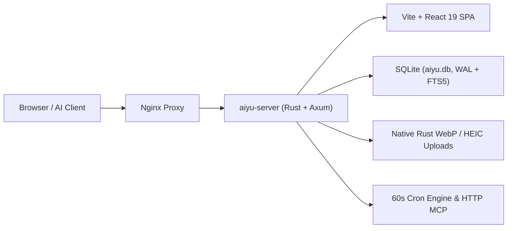

---

## ⚡ Performance

Engineered to run comfortably on a **1 GB VPS** with zero external database. Measured on fresh `--no-cache` production Docker builds with an identical 80 MB backup ([full benchmark report](development/benchmark.md)):

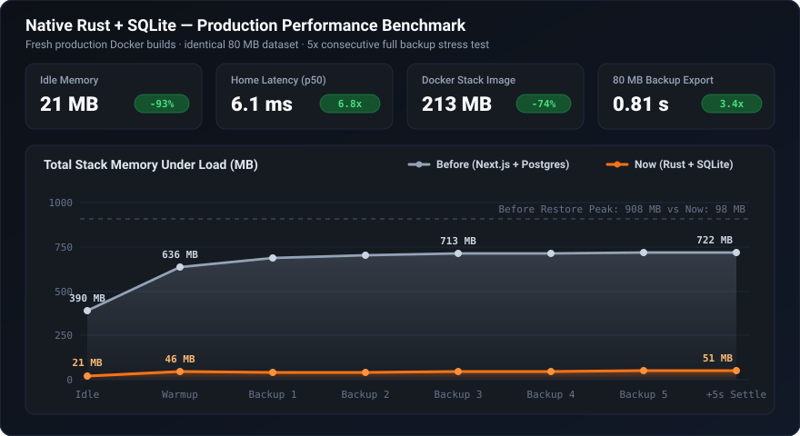

| Metric | Before (Next.js + Postgres) | Now (Rust + SQLite) | Improvement |
|---|---:|---:|---:|
| Docker App Image | 546 MB (+ ~275 MB Postgres) | **213 MB** (self-contained) | **-61%** (-74% stack) |
| Idle / After 5x Backups RSS | 282 MB / 613 MB (+ 109 MB pg) | **21 MB / 51 MB** | **-93% / -92%** |
| 80 MB Backup Export / Restore | 2.74 s / 3.42 s | **0.81 s / 1.60 s** | **3.4x / 2.1x faster** |
| `/` Payload & p50 Latency | 1,089 KB · 41.7 ms | **54 KB · 6.1 ms** | **-95% · 6.8x faster** |
| `/blogs` Payload & p50 Latency | 5,698 KB · 205.9 ms | **389 KB · 45.9 ms** | **-93% · 4.5x faster** |

---

## ✨ Key Features

- **AI Neural Core (Gemini):** Generate 64+ token light/dark themes, project copy, and dynamic subtitles from the admin panel.
- **Resume Studio:** Full-screen LaTeX resume IDE with live PDF preview, visual/code modes, snapshots, and AI job-tailoring.
- **Task Scheduler & Encrypted Secrets:** 60s Rust cron engine with visual builder, webhook jobs, image optimization, and AES-256 `$env` secrets.
- **Dual-Route Notifications:** Forward contact leads to n8n webhooks and push channels (Discord, Telegram, ntfy) simultaneously.
- **52+ Live Themes:** One-click switching (Dracula, Tokyo Night, Nord, Catppuccin, etc.) with live token editing.
- **Blog & Masonry Gallery:** Markdown editor with FTS5 search, Notion sync API, native Rust WebP conversion, and HEIC upload support.
- **MCP Server & Ops Dashboard:** Built-in HTTP Model Context Protocol server, API docs, live host health metrics, and AI log analysis.

---

## 🎬 Watch the Story

Scroll-driven life story recorded from the production build (`pnpm record`, 2× speed):

<table>
  <tr>
    <th>Desktop</th>
    <th>Mobile</th>
  </tr>
  <tr>
    <td><a href="journey-desktop.mp4">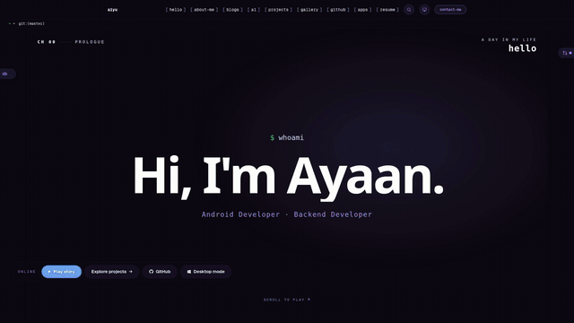</a></td>
    <td><a href="journey-mobile.mp4"></a></td>
  </tr>
</table>

<details>
<summary><strong>📸 View Screenshots (Desktop & Mobile Dark Mode)</strong></summary>

| Module | Desktop (1920x1080) | Mobile (430x932) |
|---|---|---|
| **Home** | [](public/screenshots/desktop-dark-home.png) | [](public/screenshots/mobile-dark-home.png) |
| **About** | [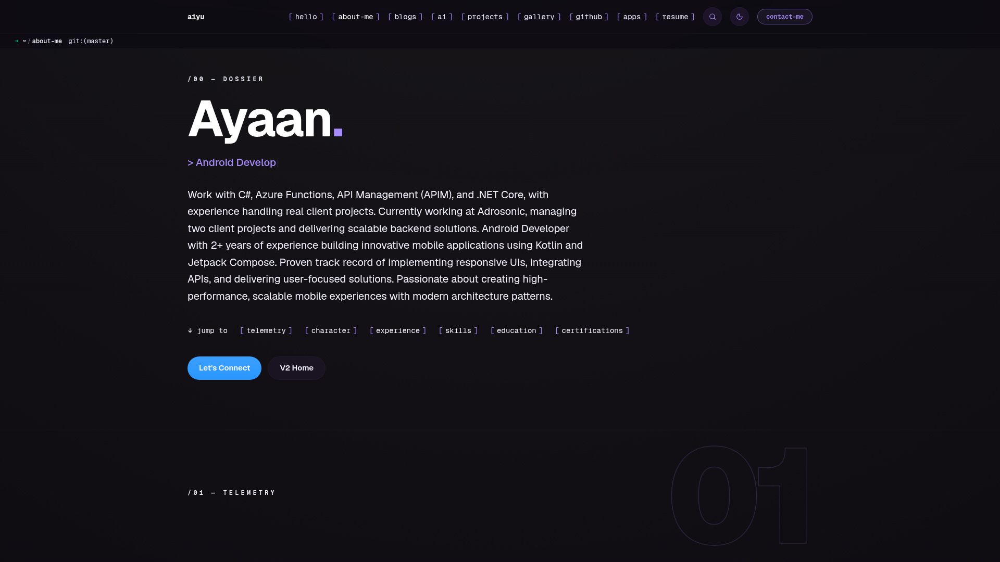](public/screenshots/desktop-dark-about.png) | [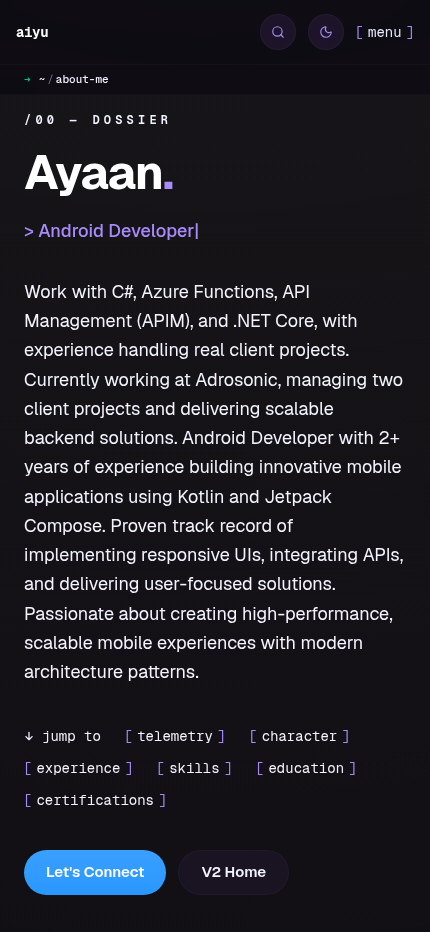](public/screenshots/mobile-dark-about.png) |
| **Projects** | [](public/screenshots/desktop-dark-projects.png) | [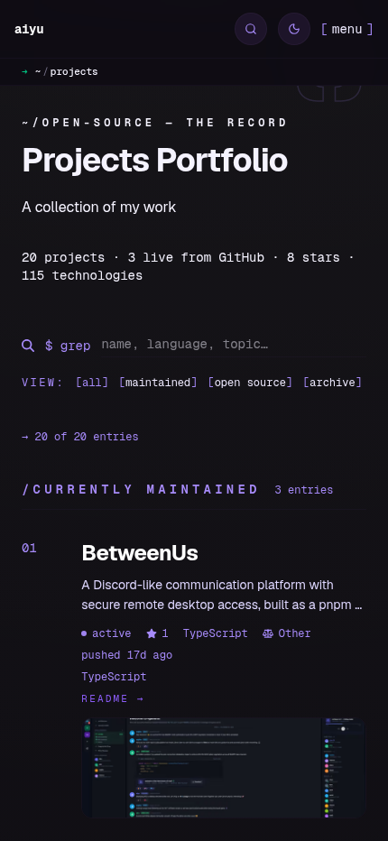](public/screenshots/mobile-dark-projects.png) |
| **Apps** | [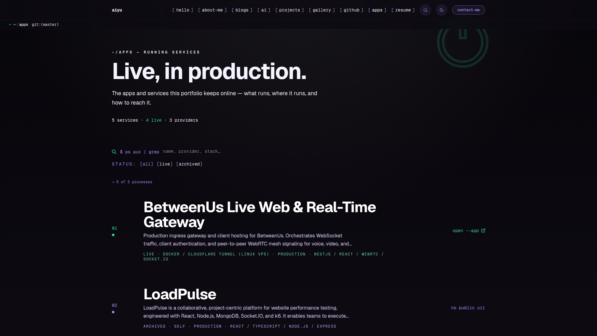](public/screenshots/desktop-dark-apps.png) | [](public/screenshots/mobile-dark-apps.png) |
| **Blogs** | [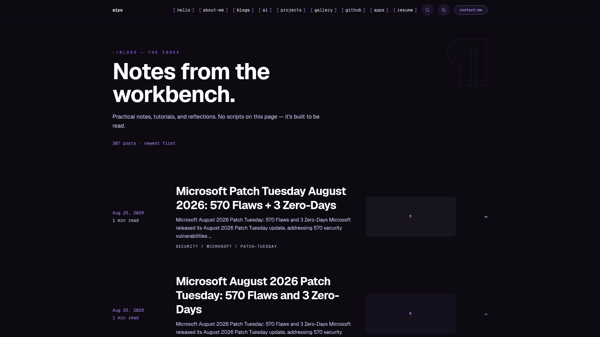](public/screenshots/desktop-dark-blogs.png) | [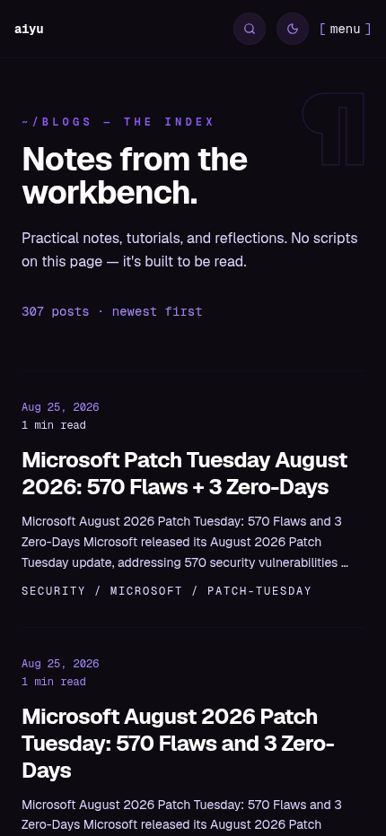](public/screenshots/mobile-dark-blogs.png) |
| **Gallery** | [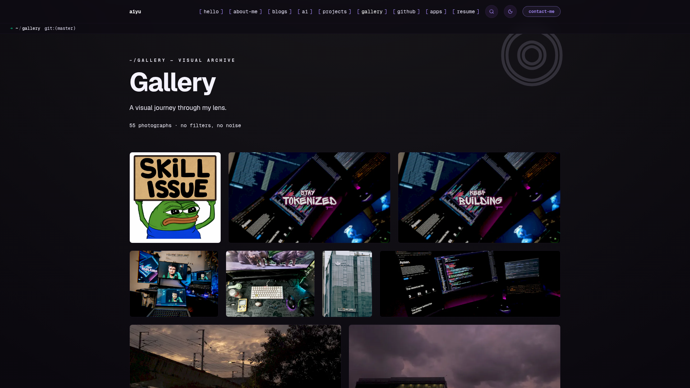](public/screenshots/desktop-dark-gallery.png) | [](public/screenshots/mobile-dark-gallery.png) |
| **GitHub** | [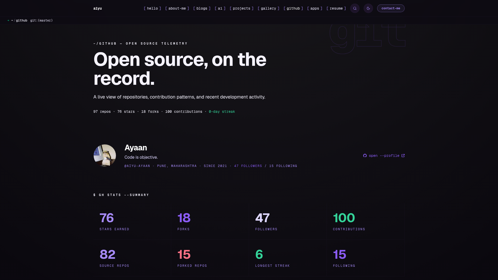](public/screenshots/desktop-dark-github.png) | [](public/screenshots/mobile-dark-github.png) |
| **Contact** | [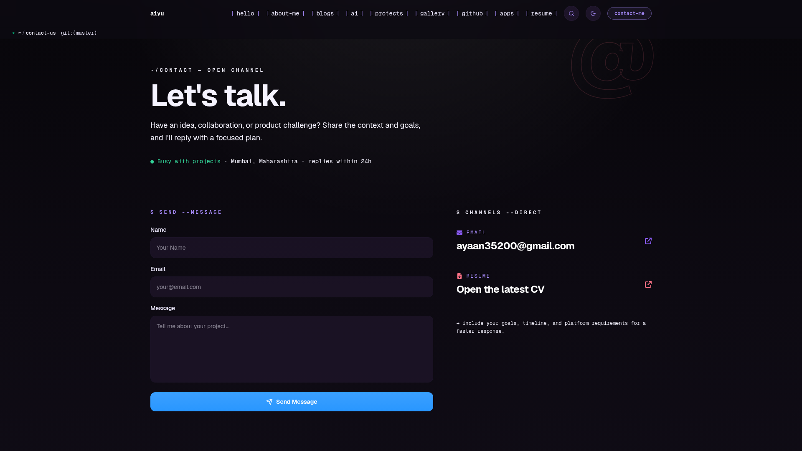](public/screenshots/desktop-dark-contact.png) | [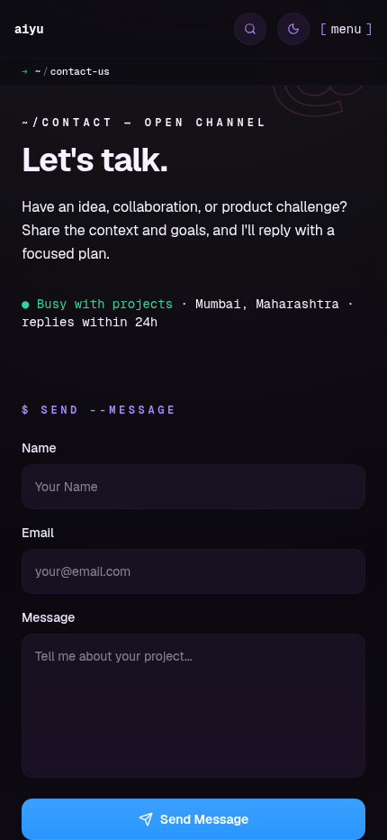](public/screenshots/mobile-dark-contact.png) |
| **Admin** | [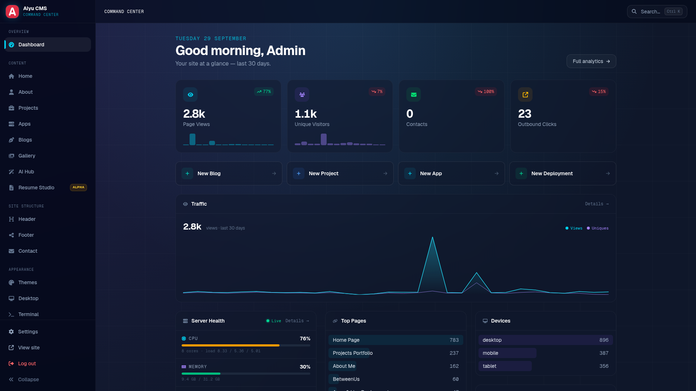](public/screenshots/admin/desktop-dashboard.png) | [](public/screenshots/admin/mobile-dashboard.png) |

</details>

---

## 🚀 Quick Start

### Docker (Recommended)

Runs in a hardened, read-only Debian-slim Rust + Vite container (`213 MB`) with embedded SQLite (`/app/data/aiyu.db`) behind Nginx — no external database needed.

```bash
git clone https://github.com/aiyu-ayaan/Aiyu.git && cd Aiyu
cp .env.example .env
# Set ADMIN_USERNAME, ADMIN_PASSWORD, and a generated JWT_SECRET in .env:
node -e "console.log('JWT_SECRET=' + require('crypto').randomBytes(64).toString('hex'))"

pnpm docker:up          # prebuilt image (docker-compose.yml)
# or: pnpm docker:up:dev  (build locally via docker-compose.local.yml)
pnpm docker:verify      # verify non-root, read-only rootfs, cap drops
```

Open **Portfolio** at `http://localhost` and **Admin** at `http://localhost/admin`.

> [!NOTE]
> Upgrading from PostgreSQL? Follow [development/docs/SQLITE_CUTOVER.md](development/docs/SQLITE_CUTOVER.md) to migrate and hash-verify via `aiyu-server import-postgres`.

### Local Development

**Prerequisites:** Node 24+, `pnpm`, stable Rust toolchain (`cargo`), and `libheif1` (optional, for HEIC uploads). No external database is needed — SQLite (`data/aiyu.db`) is created, migrated, and seeded automatically on first start.

```bash
git clone https://github.com/aiyu-ayaan/Aiyu.git && cd Aiyu
cp .env.example .env    # set JWT_SECRET, ADMIN_USERNAME, ADMIN_PASSWORD
pnpm install
pnpm dev                # starts Vite (:3000) + debug aiyu-server (:8080)
```

- **Site:** `http://localhost:3000` (hot-reloads on save; override ports with `PORT` and `RUST_PORT`)
- **Admin Panel:** `http://localhost:3000/admin/login`
- **Local Production Build:** `pnpm build && pnpm start` (serves release binary + `web/dist` on `http://localhost:8080`)
- **Backup / Restore:** Export or import full site ZIPs (DB + uploads) directly from **Admin → Database** (`/api/admin/export` & `/api/admin/import`).

---

## 🧪 Tests, Checks & Benchmarks

```bash
pnpm test               # Vitest unit & component tests
pnpm test:ui            # Playwright end-to-end tests
pnpm server:test        # Rust unit & integration tests
pnpm lint && pnpm web:typecheck

# Memory + latency benchmark against a running server:
node --env-file=.env scripts/perf/bench.mjs --url http://localhost:8080 --pid <server-pid> --backups 5
```

---

## 🛠️ Tech Stack & Docs

- **Backend:** Rust (Axum), Tokio, SQLx, SQLite (WAL + FTS5), native `image`/`libwebp-sys`/`libheif1`, JWT, AES-256-CBC
- **Frontend:** Vite 8, React 19, React Router 7, Tailwind CSS 4, Framer Motion, GSAP
- **Security:** Non-root container, `read_only` rootfs, `noexec /tmp`, `cap_drop: ALL`, rate limiting, CSP headers
- **Wiki:** [Quick Start](https://github.com/aiyu-ayaan/Aiyu/wiki/Quick-Start) · [Admin Manual](https://github.com/aiyu-ayaan/Aiyu/wiki/Admin-Panel-Manual) · [Deployment](https://github.com/aiyu-ayaan/Aiyu/wiki/Deployment-Guide) · [Security](https://github.com/aiyu-ayaan/Aiyu/wiki/Security-Guide) · [API Docs](https://github.com/aiyu-ayaan/Aiyu/wiki/API-Documentation)

**Licensed under [MIT](LICENSE)** • Maintained by [Aiyu Ayaan](https://github.com/aiyu-ayaan).
