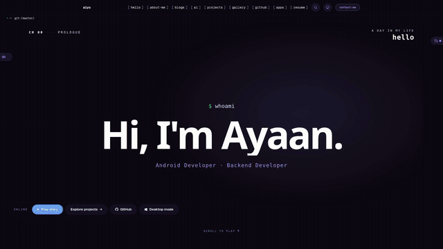
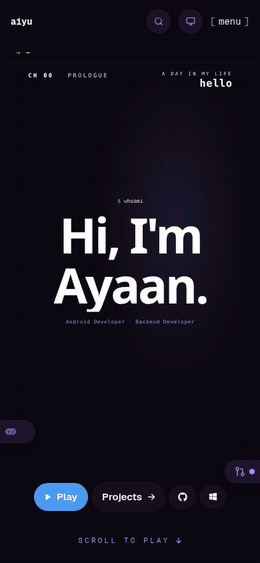

# Documentation

Local documentation for Aiyu (Rust/Axum + Vite/React 19 + SQLite), alongside supplemental guides on the [GitHub Wiki](https://github.com/aiyu-ayaan/Aiyu/wiki).

---

## Repository Guides

### Architecture, Deployment & Operations
- **[Docker Guide](DOCKER_GUIDE.md)** — Multi-stage Debian-slim image (~213 MB), Compose files, SQLite & upload volumes, `aiyu-server healthcheck`, and hardening
- **[Deployment Guide](DEPLOYMENT.md)** — Production deployment via Docker Compose or native binary
- **[Architecture Diagram](ARCHITECTURE_DIAGRAM.md)** — System architecture (NGINX → Rust/Axum → SQLite + Vite/React 19)
- **[SQLite Cutover Guide](../development/docs/SQLITE_CUTOVER.md)** — One-time migration from PostgreSQL to SQLite (`aiyu-server import-postgres`)
- **[Server README](../server/README.md)** — Rust/Axum backend architecture, migrations, and CLI subcommands

### APIs, Integrations & Admin
- **[MCP & API Integration Guide](MCP_GUIDE.md)** — Built-in `/api/mcp` StreamableHTTP server, tools, resources, prompts, and client setup
- **[API Documentation](API_DOCUMENTATION.md)** — REST API overview
- **[Admin Panel Manual](admin_manual.md)** — Managing content, themes, security, and backups
- **[DNS-AID](DNS_AID.md)** — Agent discovery via DNS
- **[Internet Archive](InternetArchive.md)** — Scheduled Save Page Now snapshots

### Optimization & Design
- **[V2 Design](V2_DESIGN.md)** — Scroll-driven story and visual design notes
- **[Gallery Optimization](GALLERY_OPTIMIZATION.md)** — Image optimization notes
- **[SEO Optimization](SEO_OPTIMIZATION.md)** — SEO configuration and best practices
- **[SEO Testing](SEO_TESTING.md)** — SEO verification tools

---

## GitHub Wiki

Additional reference pages and walkthroughs are also available on the **[GitHub Wiki](https://github.com/aiyu-ayaan/Aiyu/wiki)**:

- **[Quick Start](https://github.com/aiyu-ayaan/Aiyu/wiki/Quick-Start)** · **[Installation Guide](https://github.com/aiyu-ayaan/Aiyu/wiki/Installation-Guide)** · **[Configuration](https://github.com/aiyu-ayaan/Aiyu/wiki/Configuration)**
- **[Admin Panel Manual](https://github.com/aiyu-ayaan/Aiyu/wiki/Admin-Panel-Manual)** · **[Content Management](https://github.com/aiyu-ayaan/Aiyu/wiki/Content-Management)** · **[Theme Customization](https://github.com/aiyu-ayaan/Aiyu/wiki/Theme-Customization)**
- **[Security Guide](https://github.com/aiyu-ayaan/Aiyu/wiki/Security-Guide)** · **[Monitoring](https://github.com/aiyu-ayaan/Aiyu/wiki/Monitoring)** · **[Common Issues](https://github.com/aiyu-ayaan/Aiyu/wiki/Common-Issues)**

---

## Story Videos

The v2 home page tells my life story as a scroll-driven film, from the hero to chapter 09. These recordings come straight from the production build (`pnpm record`, 2× speed).

<table>
  <tr>
    <th>Desktop</th>
    <th>Mobile</th>
  </tr>
  <tr>
    <td><a href="../journey-desktop.mp4"></a></td>
    <td><a href="../journey-mobile.mp4"></a></td>
  </tr>
</table>

The previews run at 3× the recording. Click one to watch the full 2× MP4 in GitHub's player: [journey-desktop.mp4](../journey-desktop.mp4) · [journey-mobile.mp4](../journey-mobile.mp4).

Re-record both with `pnpm record` (options: `--speed`, `--device desktop|mobile`, `--fps`, `--skip-build`; see `scripts/record-story.mjs`).

---

## Screenshots

Screenshots are stored in `docs/images/` and can be referenced in the wiki using raw GitHub URLs:

```markdown

```
